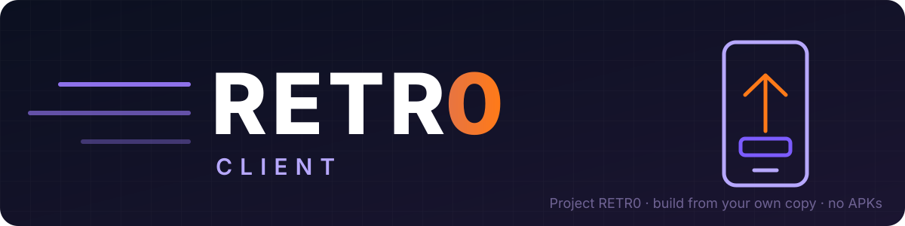
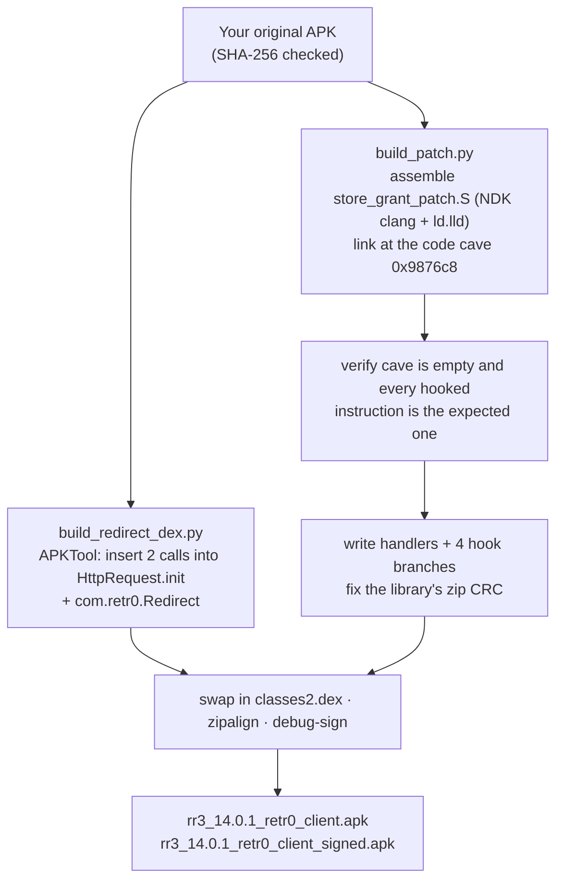

<p align="center">
  
</p>

<p align="center">
  <a href="https://github.com/Tankonline/RETR0-Client/actions/workflows/ci.yml"></a>
  <a href="LICENSE"></a>
  <a href="LICENSE-DOCS.md"></a>
  
  
  
</p>

<p align="center">
  <b>Turns your own copy of Real Racing 3 (Android 14.0.1) into the RETR0 client</b>: a client that talks to the
  <a href="https://github.com/Tankonline/RETR0-Server">RETR0 Server</a> on your PC, with preservation features added.
</p>

<p align="center">
  <a href="docs/building.md"><b>Build</b></a> ·
  <a href="docs/installing.md"><b>Install</b></a> ·
  <a href="docs/how-the-client-is-patched.md"><b>How it works</b></a> ·
  <a href="https://github.com/Tankonline/RETR0-Server"><b>RETR0 Server</b></a> ·
  <a href="CHANGELOG.md"><b>Changelog</b></a>
</p>

> [!IMPORTANT]
> **No APK is published here, and none ever will be**, neither original nor patched: a patched APK is still EA's game.
> Every build reads **your own** original APK (SHA-256 checked) and writes a new file next to it.

---

## Features

| | Feature | What it does |
|:---:|---|---|
| 🔌 | [**Built-in server redirect**](docs/features/server-redirect.md) | CloudCell and asset-CDN traffic goes to the RETR0 server (`127.0.0.1:8780`). No Frida, no time limit; every other host is untouched |
| 🏁 | [**Special events**](docs/features/special-events.md) | Grand Prix / Special Events open again: they only needed a working connection |
| 💰 | [**Store preservation grants**](docs/features/store-grants.md) | BUY on a currency package or pack gives its contents through the game's own non-purchase reward path, with amounts from the game's catalogue |
| 🏷️ | [**Player name**](docs/features/username.md) | Enter Racing Code sets the name shown instead of "Guest" on Profile and in race results |

## How the patch works



| Hook | Game function | Feature |
|---|---|---|
| `0xb8d6e4` | `NimbleMTX::PurchaseStoreProduct` | Store grants: currency packages |
| `0x13ef7e8` | `PackManager` pack purchase | Store grants: currency packs |
| `0x135e944` | Player-name function | Player name |
| `0x1516b1c` | Racing-code submit | Player name |
| `HttpRequest.init` | Java (smali) | Server redirect |

Details, including lessons learned (like the `x8` return register): **[docs/how-the-client-is-patched.md](docs/how-the-client-is-patched.md)**.

## Build

You need your original `real-racing-3-14-0-1.apk`
(SHA-256 `dcfe3788004444bd69e2fb839c18a973b488e94f46f1b818b6c005afdcad1d5f`), Python 3, Java + APKTool 3.0.3, the
Android NDK 28 and build-tools 36.

```powershell
python patches\local_server_redirect\build_redirect_dex.py --apk <apk> --out build\apk --apktool <apktool_3.0.3.jar>
python patches\store_grant_patch\build_patch.py --apk <apk> --out build\apk `
    --ndk-bin <sdk>\ndk\28.2.13676358\toolchains\llvm\prebuilt\windows-x86_64\bin --build-tools <sdk>\build-tools\36.0.0
```

| Output | Use |
|---|---|
| `build\apk\rr3_14.0.1_retr0_client.apk` | Swap into an existing install: keeps your progress |
| `build\apk\rr3_14.0.1_retr0_client_signed.apk` | Debug-signed, for a new install |

Builds are **reproducible**: the same original APK gives byte-identical outputs. More: [docs/building.md](docs/building.md).

## Install and play

With the [RETR0 Server](https://github.com/Tankonline/RETR0-Server): copy the APKs into `server\client\apk\`, then

```powershell
server\client.ps1 apply          # in-place swap, keeps your data
server\retr0_server.cmd start -WithSync
server\play.cmd
```

See [docs/installing.md](docs/installing.md).

## Repository layout

```
patches/local_server_redirect/   Redirect.smali + build_redirect_dex.py
patches/store_grant_patch/       store_grant_patch.S (ARM64 handlers) + build_patch.py
docs/                            how it works, building, installing, one page per feature
```

## Legal

Code is [MIT](LICENSE); documentation is [CC BY 4.0](LICENSE-DOCS.md). Read the [disclaimer](DISCLAIMER.md).
Real Racing 3 is a trademark of Electronic Arts Inc. This project is not affiliated with or endorsed by EA, Firemonkeys
or Glu.
