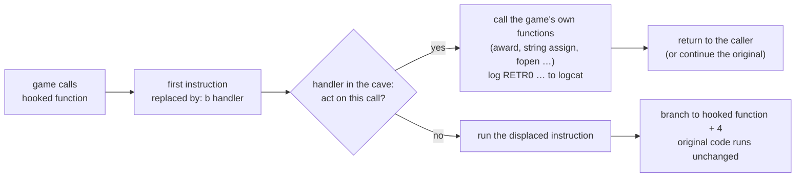

# How the RETR0 client is patched

The RETR0 client is **your own original APK** with **one changed file**: a small native patch in
`lib/arm64-v8a/libRealRacing3.so`. Nothing else in the APK changes (0.1.0 also replaced `classes2.dex` for the
redirect; since 0.2.0 the redirect is native too). The sources are in [`patches/`](../patches/).

## 1. Native patch: a code cave

The arm64 library has **0x938 bytes of zero padding** at `0x9876c8`, between `.eh_frame` and `.text`, inside the
executable segment. Our handler code goes there.

1. [`store_grant_patch.S`](../patches/store_grant_patch/store_grant_patch.S) (ARM64 assembly: the hook entry
   points and most handlers) and [`retr0_redirect.c`](../patches/store_grant_patch/retr0_redirect.c) (freestanding
   C: the URL rewrite) are written for this project. They are built with the NDK's
   `clang --target=aarch64-linux-android` (the C with `-Os -fno-pic -fno-pie -ffreestanding -fno-builtin
   -mgeneral-regs-only`) and linked with `ld.lld` by [`cave.ld`](../patches/store_grant_patch/cave.ld) at the cave
   address, with every game address they call given as `--defsym` symbols (so the linker computes all branches).
   The build checks that `.text` is the only allocated section and that nothing needs writable data: everything,
   constant strings included, must sit inside the cave.
2. [`build_patch.py`](../patches/store_grant_patch/build_patch.py) reads your original APK (checking its
   SHA-256), checks the cave really is all zeros and that each hooked instruction is exactly what it expects, then:
   - writes the handler into the cave;
   - replaces the **first instruction** of each hooked function with a `b` (branch) to its handler. Each handler
     runs that displaced instruction itself and branches back to the next one, so the original function continues
     unchanged when the handler decides not to act;
   - fixes the library's CRC in the zip's local and central headers. The library is stored uncompressed, so its
     size and offset don't change.

Hooks in the current client:

| Hook | Function | Feature |
|---|---|---|
| `0xb8d6e4` | `NimbleMTX::PurchaseStoreProduct` | [Store grants](features/store-grants.md) (currency packages) |
| `0x13ef7e8` | `PackManager` pack purchase | [Store grants](features/store-grants.md) (currency packs) |
| `0x135e944` | player-name function | [Username](features/username.md) |
| `0x1516b1c` | racing-code submit | [Username](features/username.md) |
| `0x1ce350c` | native wrapper that hands each CloudCell request to Java `HttpRequest.init` | [Server redirect](features/server-redirect.md) |

The handlers call the game's own functions (store lookup, reward parser, the non-purchase award, save request,
logging, `std::string` assign) and libc through the library's own PLT stubs (`fopen`, `fgets`, `fputs`, `fclose`,
`malloc`). Each handler logs a `RETR0 …` line to logcat.

### Lessons learned

- **Check the calling convention in the disassembly, not the pseudocode.** A C++ function returning a
  `std::string` by value receives the result's address in **`x8`** (AAPCS64 indirect result register). Ghidra shows it
  as a normal first parameter. The first username build wrote to `x0` and corrupted an unrelated object.
- **Writable scratch memory** is scarce in a patch. The username handler keeps 16 bytes of state in the unused tail
  of a static 24-byte string that nothing reads (verified by scanning all code for references); the redirect's log
  counter uses one more byte of it.
- **Compiled C must not use a GOT.** The first C build loaded a global through a GOT slot outside the cave (that
  memory is never written into the game), so it would have crashed on the first request. `-fno-pic -fno-pie` plus
  the allocated-section check prevent it.

## 2. The redirect, and the old Java version

The server redirect is the fifth hook above. 0.1.0 did it in Java instead
([`Redirect.smali`](../patches/local_server_redirect/Redirect.smali) via
[`build_redirect_dex.py`](../patches/local_server_redirect/build_redirect_dex.py), which needed Java and APKTool);
that version is kept for reference only. Details: [features/server-redirect.md](features/server-redirect.md).

## 3. Putting the APK together

`build_patch.py` writes:

| Output | What |
|---|---|
| `rr3_14.0.1_retr0_client.apk` | The patched library in your original APK, **zip-aligned** (`zipalign -P 16 4`: stored `.so` files on 16 KB pages) |
| `rr3_14.0.1_retr0_client_signed.apk` | The same, signed with the Android **debug** key (for a new install) |
| `patch_data.json` | The built cave bytes and each hook's expected and new instruction: everything a standalone patcher needs (planned) |

The builds are reproducible: the same inputs give byte-identical APKs.

## 4. Installing without losing data

The game loads its native libraries straight from `base.apk` (`extractNativeLibs=false`), and Android does not
re-check an installed APK's signature when the app starts. So `client.ps1 apply` can, as root:

1. stop the game;
2. copy the new APK over the installed `base.apk`, keeping its owner, mode, SELinux label and timestamp;
3. run `cmd package compile -f -m verify` so Android recompiles the changed Java code.

All game data and downloads stay in place. `client.ps1 restore` does the same with the original APK.

**But not across a reboot.** When the emulator restarts, Android re-checks installed APKs, finds that `base.apk` no
longer carries EA's signature, and removes the app's code. It keeps the app record and all data (saves, the name file,
downloaded assets). Reinstall the original APK over it (`adb install -r`, same signature, data kept) and run
`client.ps1 apply` again. A permanent install needs the signed APK, which today means a fresh install.

## 5. Diagnostic builds

During research the same pipeline built temporary diagnostic clients that log a value. Examples: who calls the
popup functions (special events), which text lookups return "Guest" (username). These are never part of the
normal client. The method: hook the function's first instruction, call the original through a trampoline, log
through the game's own printf-style logger (`0x109fa18`) with the caller's return address, and return.
